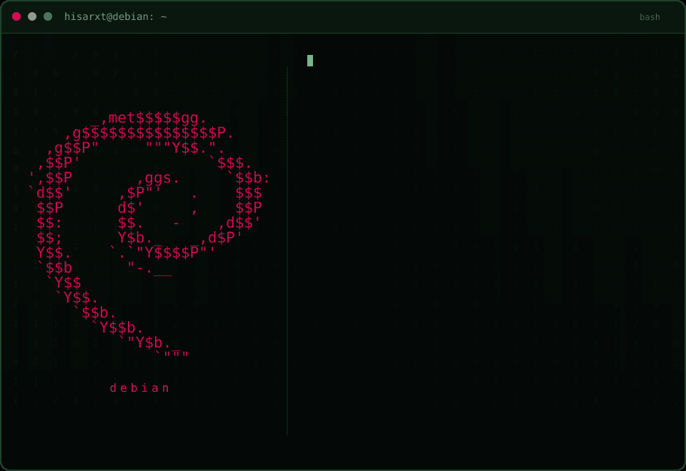

  

    

Sobre mim
Desenvolvedor back-end e estudante de Engenharia de Software na Universidade de Brasília (UnB). Trabalho com APIs REST, integração entre sistemas, automação com Python e aplicações de inteligência artificial.
CAIXA Econômica Federal · Estagiário em Desenvolvimento: APIs REST/OData em SAP ABAP, integração com micro front-ends Angular e otimização de consultas SQL.
NoFluxo UnB · Cofundador e mantenedor back-end: plataforma open source com 3.500+ usuários, voltada ao planejamento acadêmico. Atuo com scraping, pipelines ETL, RAG, agentes de IA e extração de dados de PDFs com visão computacional.
Idiomas: francês fluente e inglês avançado.
Projetos em destaque
NoFluxo UnB
Planejamento acadêmico com fluxogramas interativos e assistente de IA para a comunidade da UnB. Minha atuação inclui coleta de dados com BeautifulSoup e multithreading, pipelines ETL, sistemas RAG e automação de atualizações com GitHub Actions.
Projeto	Tecnologias / área	Destaque
DSList	Java · Spring Boot · JPA · PostgreSQL	API REST para listar jogos e organizar listas personalizadas.
Studies JPA Repository	Java · JPA	Repositório de estudos em persistência de dados.
Tecnologias e interesses
Back-end   → Python · TypeScript · Java · SAP ABAP
APIs       → REST · OData · Spring Boot · Integração de sistemas
Dados      → Pandas · SQL · PostgreSQL · ETL · BeautifulSoup
IA         → LLMs · RAG · Agentes de IA · Visão computacional
Entrega    → Git · GitHub Actions · Scrum · Kanban · Open source
